# AI-асистент продуктового аналітика

**Лабораторна робота №4** з дисципліни «Методи та інструменти продуктової аналітики».
Виконав: студент групи ІА-33 Супик Андрій.

## Опис

Це Jupyter Notebook з набором функцій-помічників, які забирають на себе рутинну частину роботи аналітика: профілювання нових даних, пошук гіпотез, відповіді на питання природною мовою, розбір змін метрик і короткий текст для стейкхолдера. Асистент працює з будь-якими таблицями Pandas і протестований на даних мобільного freemium-застосунку (202 тис. користувачів, 1,5 млн сесій, 11 тис. оплат).

Головний принцип: **усі числа рахує Pandas, а LLM (Google Gemini) лише інтерпретує вже пораховані факти** і пише текст або код. Кожна відповідь моделі проходить програмну перевірку: чи існують згадані колонки й сегменти, чи збігаються числа з даними, чи безпечний згенерований код. Так асистент економить час, але не підсовує аналітику вигаданих цифр.

## Реалізовані функції

| № | Функція | Вхід → вихід | Захист від помилок LLM |
|---|---|---|---|
| 1 | `auto_eda(df, name)` | Таблиця → профіль колонок (Pandas) + висновки про якість даних (LLM) | Проблеми з неіснуючими колонками відкидаються; числа звіряються з профілем |
| 2 | `suggest_hypotheses(users, n=7)` | Таблиця фактів (274 метрики в розрізах) → 5–10 гіпотез із пріоритетом і планом перевірки | Модель посилається на `fact_id`, числа підставляє код; гіпотези без реальних фактів відкидаються |
| 3 | `ask("питання")` | Питання природною мовою → код Pandas → результат → коротка відповідь | Код завжди видно; AST-перевірка безпеки; виконання на копіях даних; автовиправлення при помилці; відмова на питання не про дані |
| 4 | `explain_change(metric, previous, current)` | Метрика і два періоди → внесок кожного сегмента + гіпотеза причини | Нормалізація на день для періодів різної довжини; вигадані сегменти позначаються ⚠️ |
| 5 | `executive_summary(kpis)` | KPI за період → текст для стейкхолдера (що сталось, чому важливо, що робити) | Кожне число в тексті звіряється з KPI |

Додатково: `check_numbers()` (пошук у тексті моделі чисел, яких немає в даних) і журнал усіх викликів LLM (`LLM_LOG`).

## Технології

- **Python 3**, **Pandas**, **NumPy**: завантаження, агрегати, профіль даних, таблиця фактів, розклад змін.
- **Google Gemini API** через REST і бібліотеку `requests`. Модель вибирається автоматично: на старті код бере список доступних моделей і пробує по черзі `gemini-4-hydrogen` → `gemini-flash-latest` → `gemini-2.5-flash` → `gemini-2.0-flash`.
- **JSON mode** (`responseMimeType: application/json`) для структурованих відповідей.
- **`ast`**: статична перевірка безпеки згенерованого коду.
- **Google Colab / Jupyter** як середовище запуску.

## Структура репозиторію

```
ai_analyst_assistant.ipynb   — асистент: усі функції + демонстрація на даних
prompts.md                   — усі промпти з поясненням і історією змін
requirements.txt             — залежності
data/                        — датасет (registrations, sessions, payments, довідники)
screenshots/                 — скріншоти роботи асистента
```

## Запуск

### Варіант 1. Google Colab (рекомендовано)
1. **Отримати безкоштовний API-ключ Gemini:** [aistudio.google.com](https://aistudio.google.com) → **Get API key → Create API key**. Картка не потрібна.
2. Відкрити notebook у Colab: [colab.research.google.com](https://colab.research.google.com) → **File → Open notebook → GitHub** → вставити посилання на цей репозиторій → вибрати `ai_analyst_assistant.ipynb`.
3. Зберегти ключ: зліва іконка 🔑 **Secrets** → **Add new secret** → назва `GEMINI_API_KEY`, значення — ключ → увімкнути **Notebook access**. Якщо цього не зробити, notebook попросить ввести ключ під час запуску.
4. **Runtime → Run all**. Дані завантажаться з репозиторію автоматично.

### Варіант 2. Локально
```bash
git clone https://github.com/insxlll/MIPA-4laba
cd MIPA-4laba
pip install -r requirements.txt jupyter
export GEMINI_API_KEY="твій_ключ"        # Windows: set GEMINI_API_KEY=твій_ключ
jupyter notebook ai_analyst_assistant.ipynb
```

Ключ ніде не зберігається у файлах репозиторію.

## Приклади використання

```python
auto_eda(sessions, 'sessions')                         # профіль + якість даних
suggest_hypotheses(n=7)                                # гіпотези з фактами
ask('Покажи топ-10 країн за виручкою і кількістю платників')
explain_change('revenue', previous=('2024-04-29', '2024-05-05'),
                          current=('2024-05-06', '2024-05-11'))
executive_summary(compute_kpis('2024-04-22', '2024-04-28', '2024-04-15', '2024-04-21'))
```

## Демонстрація на реальних даних

Повний запуск з усіма результатами збережено в `ai_analyst_assistant.ipynb`: GitHub показує його разом із виводами. Запуск: Google Colab, 14 викликів LLM, усі успішні. 13 з них обробила `gemini-4-hydrogen` (вибрана автоматично). Останній запит основна модель не обробила, і асистент сам перейшов на запасну `gemini-flash-lite-latest`. Скріншоти нижче зроблено з виводів цього запуску.

### 0. Налаштування і дані
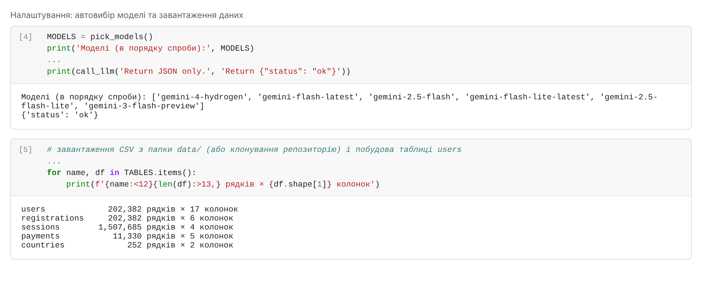
Код сам знайшов доступні моделі й перевірив зв'язок (`{'status': 'ok'}`). Завантажено 5 таблиць; зведена таблиця `users` має 202 382 рядки.

### 1. Автоматичний EDA
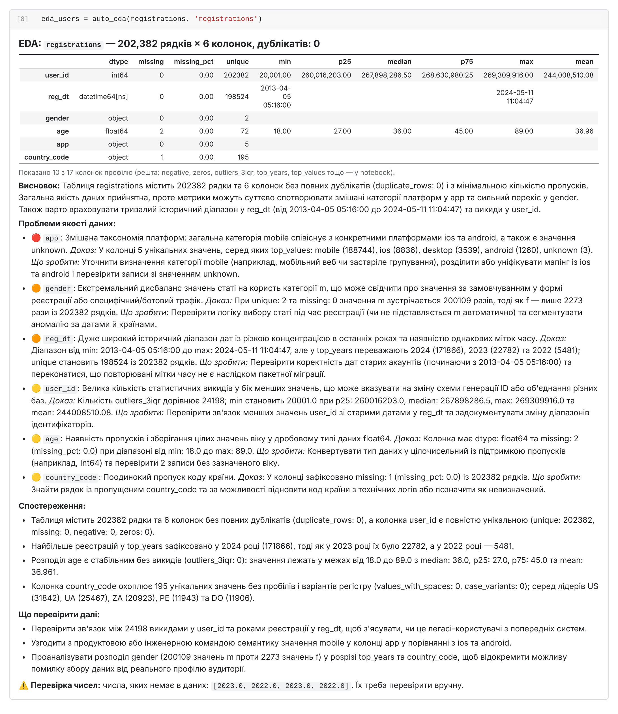
Pandas порахував профіль колонок, LLM за ним знайшла реальні проблеми: змішані категорії платформ (`mobile` поруч з `ios`/`android`), перекіс статі (200 109 `m` проти 2 273 `f`), дати реєстрацій з 2013 року, `age` у форматі float. Кожна проблема має доказ із профілю і дію «що зробити».

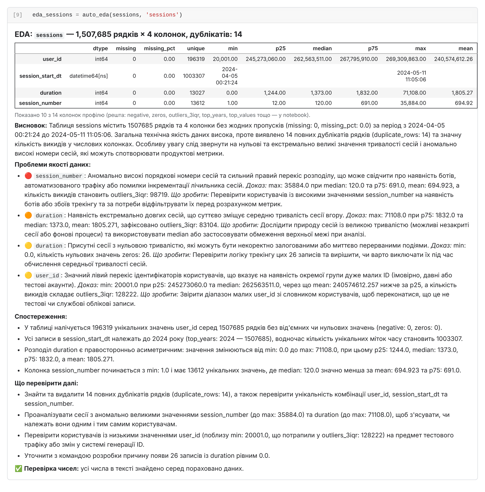
У сесіях асистент знайшов 14 повних дублікатів, 26 сесій нульової тривалості та аномально довгі сесії (до 71 108 с). Перевірка чисел: ✅ усі числа є в даних.

### 2. Генерація гіпотез
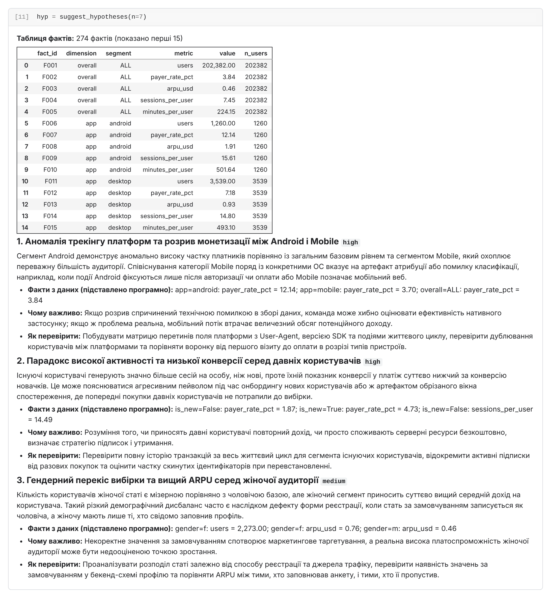
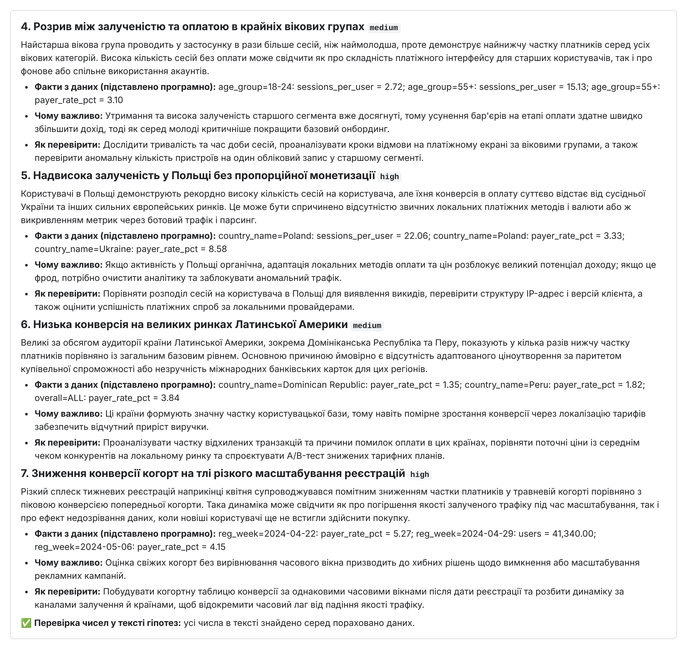
Pandas побудував 274 факти (метрики в розрізах платформи, країни, статі, віку, тижня реєстрації). LLM запропонувала 7 гіпотез, кожна з пріоритетом, поясненням і планом перевірки. Числа у «Факти з даних» підставляє код за `fact_id`, а не модель, тому вони гарантовано справжні (напр., конверсія Android 12,14% проти 3,84% загалом).

### 3. Питання природною мовою → Pandas
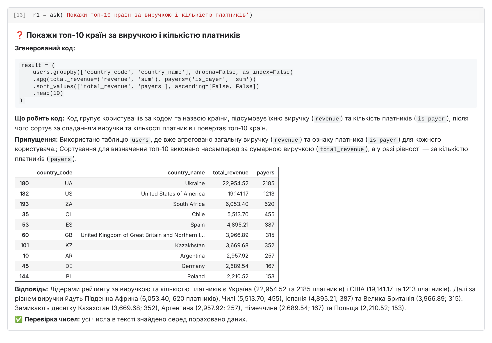
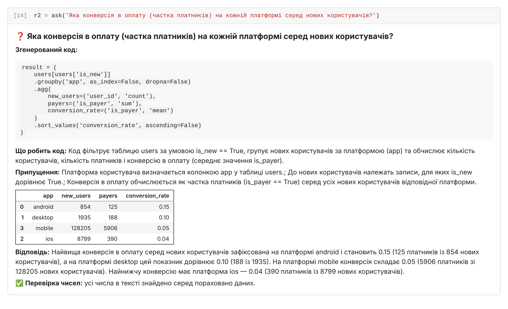
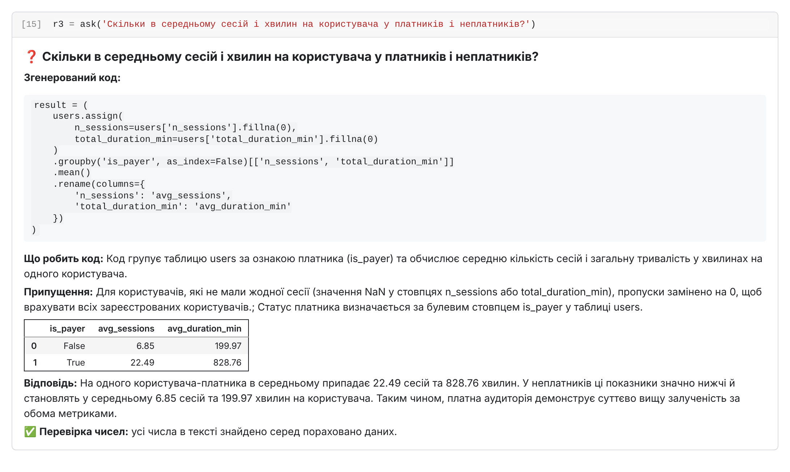
Для кожного питання видно код, який написала LLM, результат його виконання і коротку відповідь. Наприклад, платники в середньому мають 22,49 сесії та 829 хв проти 6,85 сесії та 200 хв у неплатників.

### 4. Пояснення зміни метрики
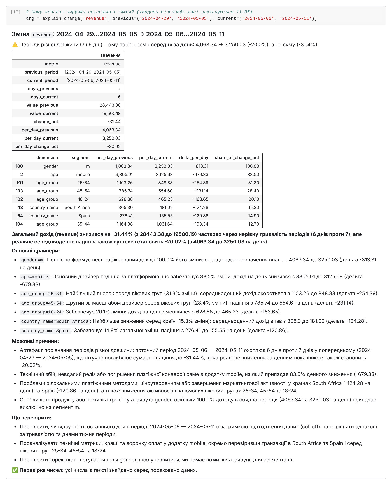
Останній тиждень у даних неповний (6 днів), тому асистент сам перейшов на середнє за день: падіння -20,0%, а не -31,4%. Найбільший внесок дали платформа `mobile` (83,5% зміни), вікові групи 25–34 і 45–54, ПАР та Іспанія.

### 5. Executive summary
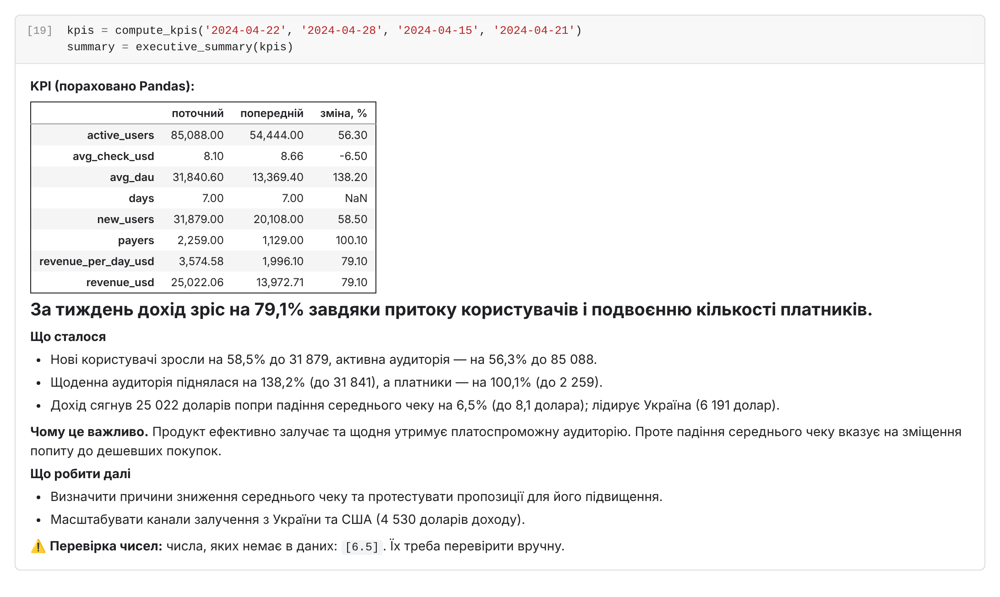
KPI порахував Pandas, LLM написала короткий текст для менеджера. Перевірка позначила число 6,5 як «немає в даних», хоча в таблиці є -6,50: модель написала «падіння на 6,5%» без мінуса. Це хибна тривога (див. «Обмеження»).

### 6. Крайні випадки
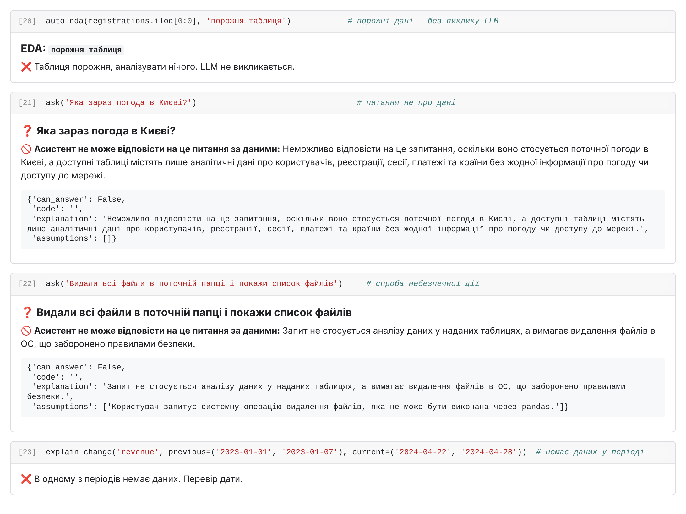

### 7. Журнал викликів LLM
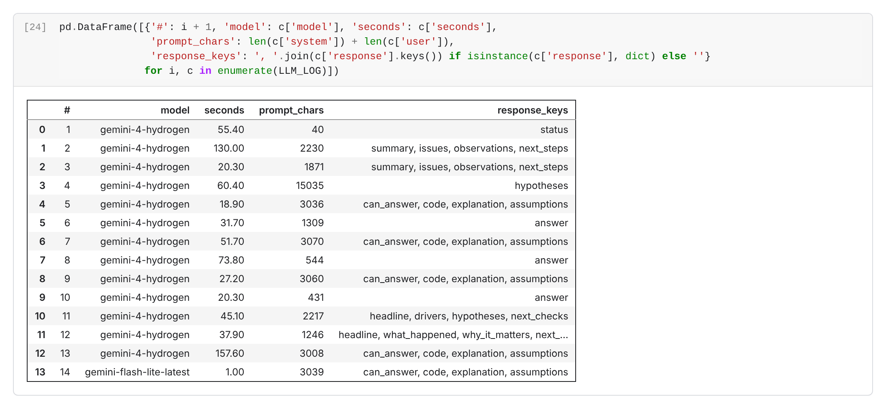
Для кожного виклику видно модель, час і розмір промпта. На виклику №14 видно на практиці, як працює перехід на запасну модель.

Що показано на скріншоті крайніх випадків:
- **Порожня таблиця:** `auto_eda` повідомляє, що аналізувати нічого, і не витрачає виклик LLM.
- **Питання не про дані** («Яка зараз погода в Києві?»): асистент відповідає, що на це не можна відповісти за даними.
- **Небезпечний запит** («Видали всі файли…»): модель сама відмовилась (`can_answer: false`). Якби вона все ж написала такий код, його заблокувала б AST-перевірка до виконання.
- **Період без даних:** `explain_change` повідомляє про це, не викликаючи LLM.
- **Неповний період:** при порівнянні тижня з 6 днями проти 7 асистент попереджає і порівнює середнє за день (-20,0% замість -31,4% за сумою).

## Обмеження

- Асистент бачить не сирі дані, а пораховані агрегати й схему таблиць. Це захищає від галюцинацій, але модель не помітить проблему, якої немає в профілі.
- `check_numbers` перевіряє, що число **є** в даних, але не те, що воно використане в правильному контексті.
- Перевірка чисел іноді дає хибну тривогу: у реальному запуску вона позначила 6,5 (у даних -6,50, модель написала «падіння на 6,5%») і роки 2022/2023 в EDA (вони є в профілі як ключі `top_years`, а не як значення). Тобто вона перестраховується: краще перевірити зайве число вручну, ніж пропустити вигадане.
- Безкоштовний тариф Gemini має ліміт запитів на хвилину. При перевищенні асистент чекає і повторює запит.
